<!-- Animated contribution graph and stats panel from real data.
     Regenerated daily by .github/workflows/update-profile-art.yml -->

<h3><code>priyanshu@github ~ $ ./contributions.sh</code></h3>

 
 

<!-- Portrait: python scripts/prep_photo.py <photo> && python scripts/make_ascii_svg.py -->

<h3><code>priyanshu@github ~ $ whoami</code></h3>

<table>
<tr>
<td valign="top"></td>
<td valign="top"></td>
</tr>
</table>

 
 

<h3><code>priyanshu@github ~ $ ./links.sh</code></h3>

<b>Website Designer · Web Developer</b>

 
 

<h3><code>priyanshu@github ~ $ ./stack.sh</code></h3>

 

