<!-- Animated contribution graph and stats panel from real data.
     Regenerated daily by .github/workflows/update-profile-art.yml -->

<h3><code>priyanshu@github ~ $ ./contributions.sh</code></h3>

 
 

<!-- Portrait: python scripts/prep_photo.py <photo> && python scripts/make_ascii_svg.py -->

<h3><code>priyanshu@github ~ $ whoami</code></h3>

<table>
<tr>
<td valign="top"></td>
<td valign="top"></td>
</tr>
</table>

 
 

<!-- Card: edit LEFT and RIGHT in scripts/make_info_card.py, then run it -->

<h3><code>priyanshu@github ~ $ ./about.sh</code></h3>

 
 

<a href="https://www.priyanshuroy.com/">priyanshuroy.com</a> · <a href="https://kinetiq.runs-on.dev">Kinetiq</a>

